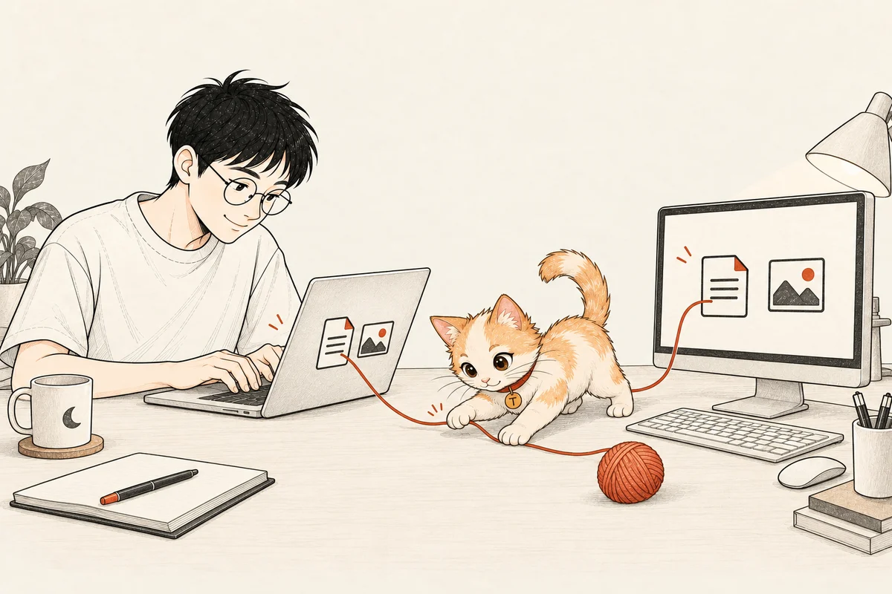
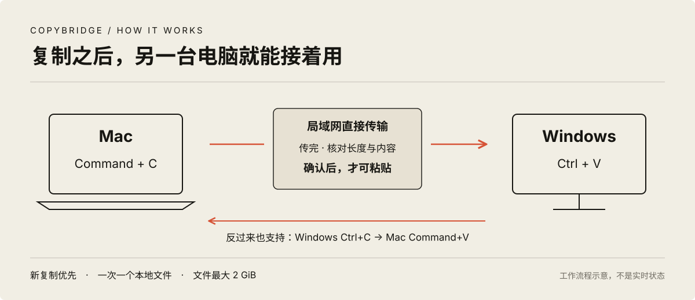

# CopyBridge · 两台电脑，一次复制

**在 Mac 复制，到 Windows 直接粘贴**

文字可以这样用<br>
文件也可以这样用<br>
反过来，同样支持



[构建与配对](docs/SETUP.md) · [实机验证与边界](docs/VERIFICATION.md) · [实现原理](docs/ARCHITECTURE.md)

## 为什么做这个

我想要的操作很简单

在 Mac 按下 Command+C<br>
走到 Windows，按下 Ctrl+V<br>
文字还是那段文字，文件还是原来的文件

CopyBridge 把这件事接起来
两台电脑通过局域网直接通信
不用把文件先发到聊天软件，也不经过中转服务器

## 怎么用

1. 两端启动 CopyBridge，完成一次配对
2. 在一台电脑复制文字、截图内容，或一个本地文件
3. 等提示“可粘贴”，在另一台电脑正常粘贴

Mac 用 **Command+C / Command+V**<br>
Windows 用 **Ctrl+C / Ctrl+V**

大文件需要先传完，再粘贴<br>
程序不会拦截快捷键，也不会替你补按粘贴



## 现在支持什么

| 内容 | 当前范围 |
| --- | --- |
| 纯文字 | 双向，中文、英文、表情、多行，最多 1 MiB |
| 静态图片内容 | 双向，最多 32 MiB、3200 万像素 |
| 单个本地文件 | 双向，不限扩展名，最多 2 GiB，保留原始字节 |
| 新复制优先 | 新内容撤销旧传输，目标电脑新复制的内容受到保护 |
| 菜单与托盘 | 状态、暂停、取消、收到的文件、解除配对、退出 |

文件夹、多文件批次、未下载的云端文件、符号链接和富文本排版暂不支持
视频按真实文件传输，目标软件是否接受视频粘贴，取决于软件自身

## 真机上做到了哪里

在作者的一台 Apple Silicon Mac 和一台 Windows 11 上：

- 文字、普通文件、PNG、JPEG 和小 MP4，双向 12 项核对通过
- Mac 原生 Command+C，到 Windows 记事本和文件夹里的 Ctrl+V，通过并核对内容
- 一个完整的 2 GiB 文件传到 Windows，大小和 SHA-256 一致
- AutoCAD 2026 接收图片内容，保存图纸、关闭后重开仍正常
- 应用重启后自动重连，等待新复制，不重放旧剪贴板

这里的结果来自这两台设备<br>
不是对所有电脑、所有网络、所有软件的保证<br>
更完整的版本和测试边界见 [验证记录](docs/VERIFICATION.md)

## 从源码开始

这是供自行构建和配对的源码版本
当前没有面向任意电脑的一键安装向导

Mac 需要 Apple Silicon 与 Swift 命令行工具（实测 macOS 26.0.1）
Windows 需要 Windows 桌面环境与 .NET 10 SDK

```sh
git clone https://github.com/tang730125633/copybridge.git
cd copybridge
sh scripts/macos/build.sh
```

Windows 在项目根目录运行：

```powershell
dotnet publish apps/windows/CopyBridge.Windows.csproj -c Release -r win-x64 --self-contained true -o build/windows
Start-Process .\build\windows\CopyBridge.exe -ArgumentList '--self-test' -Wait
```

接下来按 [构建与配对](docs/SETUP.md) 配置你自己的两台电脑
不要直接套用别人设备的证书、地址或配对资料

## 放在哪里，什么时候停

收到的文件保存在两端用户目录的 `CopyBridge Received`
退出应用不会自动删除它们，避免文档中的文件引用失效

锁屏、睡眠或断网时停止当前任务<br>
恢复后重新复制一次<br>
如果同时开着其他剪贴板同步软件，请先停用其中一套

## 项目里的几块代码

| 位置 | 负责什么 |
| --- | --- |
| `apps/macos/CopyBridge.swift` | Mac 菜单栏、剪贴板、文件快照、HTTPS 传输 |
| `apps/windows/Program.cs` | Windows 托盘、HTTPS 接口与配对 |
| `apps/windows/Bridge.cs` | 任务状态、新旧内容判定、接收与反向发送 |
| `apps/windows/NativeClipboard.cs` | Windows 原生文字、图片与文件格式 |
| `tests/protocol/check_server.py` | 连接真实接收端的协议检查工具 |

Swift / AppKit / CryptoKit · C# / .NET 10 / WPF / Kestrel

公开版本保留客户端代码与协议检查工具
不包含个人电脑地址、凭据、剪贴板内容、原始测试素材或部署历史

插画是工作原理的视觉表达，不是产品截图<br>
人物沿用我的个人网站，生成方式见 [插画说明](docs/ARTWORK.md)

唐泽龙 · [zelong.vip](https://zelong.vip)
